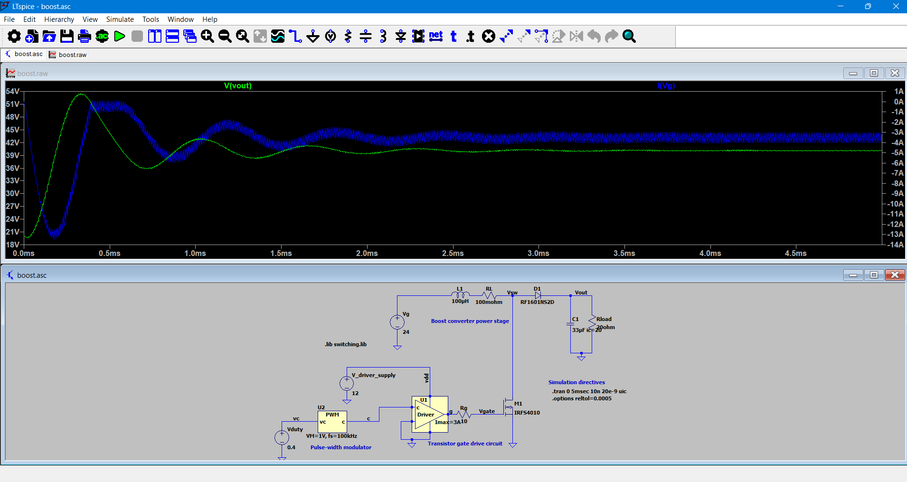
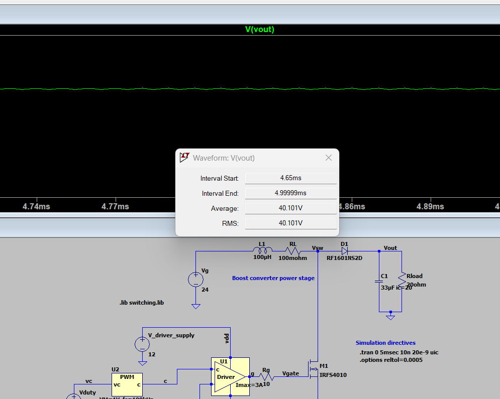
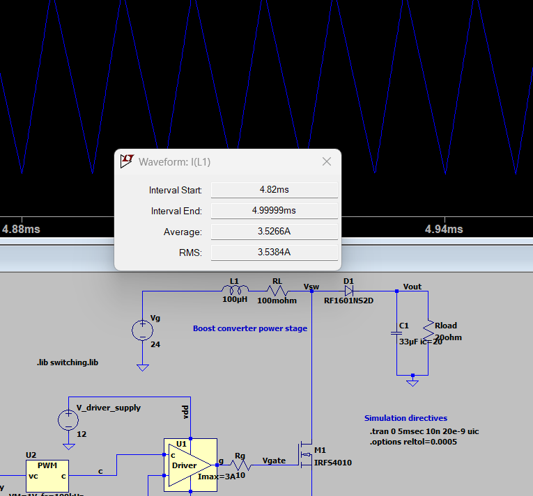
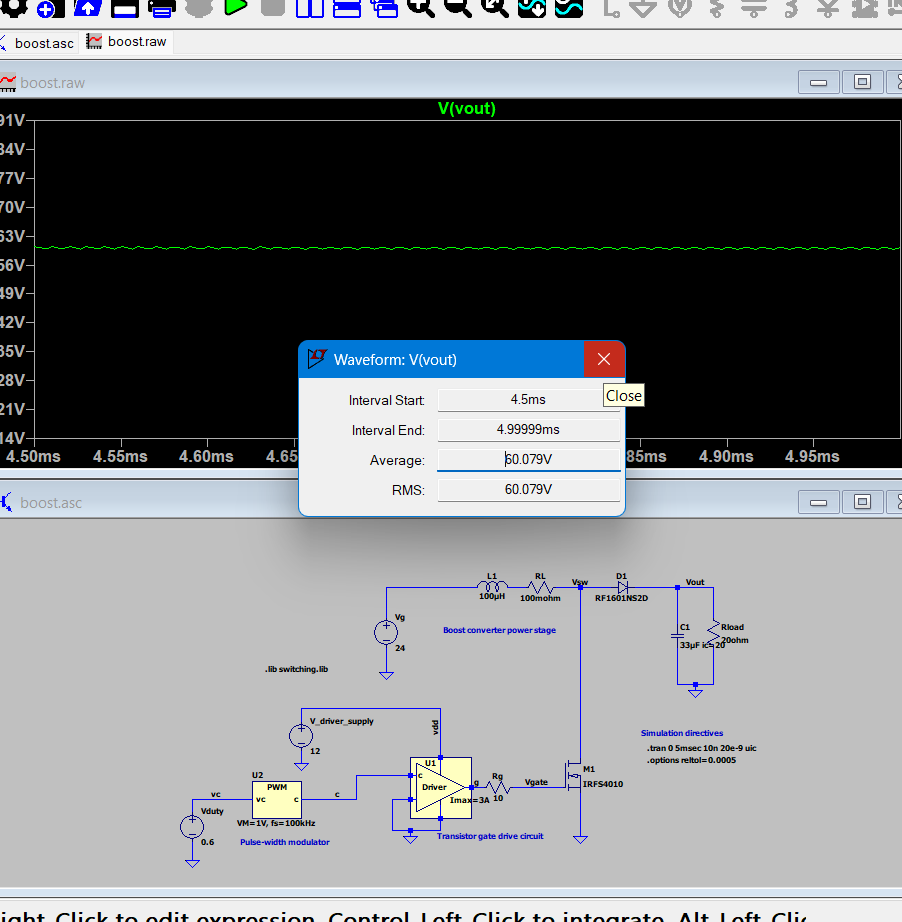

# Module 01: Boost Converter Simulation (open loop)

## In 30 seconds

A boost converter raises a DC voltage. I built one in LTspice (24 V in, about 40 V out, 20 Ω load), calculated what theory predicts, simulated it, and compared.

| Quantity | Theory | LTspice | Difference |
|----------|--------|---------|------------|
| Output voltage, duty cycle 0.4 | 40.0 V | 40.101 V | +0.25% |
| Output voltage, duty cycle 0.6 | 60.0 V | 60.079 V | +0.13% |
| Average inductor current | 3.33 A (lossless) | 3.527 A | +5.8% |
| Output power | 80.0 W | 80.375 W | +0.5% |
| Input power | 80.0 W (lossless) | 84.75 W | +5.9% |
| Efficiency | 100% (lossless) | 94.8% | |

**Reading the table:** about 4.4 W is lost as heat, so the converter draws more current than a lossless one would. Simulated output voltage is within 0.3% of theory.

**Setup:** 24 V source, MOSFET IRFS4010, diode RF1601NS2D, inductor winding resistance 100 mΩ, 20 Ω load, fixed-duty PWM (no feedback).

**Terms:** *duty cycle* is the fraction of each cycle the switch is on. *Steady state* means the circuit has settled and the averages stop changing. *Ripple* is the small up-and-down wiggle around an average.

  

<em>Output voltage from start-up to steady state. The averages below are taken after the output has settled.</em>

## 1. What	is	the	steady-state average	output	voltage	(in	volts)?

### Theoretical Expected Value
If this circuit were 100% perfect and lossless, the math for a boost converter says our $24\text{ V}$ input at a $40\%$ duty cycle ($D = 0.4$) should give us exactly **$40\text{ V}$** on the output:

$$V_{out} = \frac{V_g}{1 - D} = \frac{24\text{ V}}{1 - 0.4} = 40.0\text{ V}$$

### What LTspice Actually Simulated
Real circuits have losses, so the simulation won't hit a perfect $40\text{ V}$. After letting the simulation run and settle down ($4.5\text{ ms}$ to $5.0\text{ ms}$), I used `Ctrl + Click` on the `V(vout)` trace to find the true average:

* **Theoretical Perfect Output:** $40.0\text{ V}$
* **Actual Simulated Average :** `40.101 V`

  

**Result:** 40.101 V simulated against 40.0 V ideal (+0.25%).

Real components waste energy, and losses normally push a boost converter's output *below* the ideal value $V_{out}=\frac{V_g}{1-D}$, so losses do not explain a result slightly above 40.0 V. I have not yet traced the exact cause. Possible causes:

1. The PWM source's actual on-time differs slightly from exactly 0.4 because of finite rise and fall times.
2. The averaging window (4.5 to 5.0 ms) is not a whole number of switching periods, or the output has not fully settled.

## 2. What is the steady-state average inductor current (in amps)?

In a boost converter the inductor is in series with the input source, so the average inductor current equals the average input current.

For a lossless converter, $P_{in}=P_{out}$, so
$$I_{in}=\frac{P_{out}}{V_g}=\frac{80\ \text{W}}{24\ \text{V}}\approx 3.33\ \text{A}$$

Losses make the input current higher. As a consistency check (not an independent prediction), using the simulated efficiency of 94.8%:
$$I_{in}\approx\frac{80.375\ \text{W}}{0.948\cdot 24\ \text{V}}\approx 3.53\ \text{A}$$

**Simulated:** average 3.527 A, RMS 3.538 A. The 5.8% gap from the lossless value is the cost of losses.

  

<em>Inductor current in steady state: a triangular ripple around the average.</em>

The average inductor current is set by the power drawn from the input, because the inductor sits directly in series with the source. The MOSFET switches on and off at the switching frequency, so the current rises and falls around the average. This ripple is why the RMS value (3.538 A) is slightly higher than the average (3.527 A).

## 3.   What is the steady-state output power (in watts)?

### Theoretical Expected Value
With an ideal output voltage of 40 V across a $20\,\Omega$ resistive load, the theoretical steady-state output power is exactly 80 W:

$$P_{out} = \frac{V_{out}^2}{R_{load}} = \frac{(40\text{ V})^2}{20\ \Omega} = 80.0\text{ W}$$

### What LTspice Actually Simulated
Using the actual simulated average voltage of 40.101V, the real steady-state power delivered to the load is:

$$80.375 W$$

The simulated output power is slightly higher than the ideal 80 W because the actual steady-state voltage (40.101 V) exceeds the theoretical value (40.0 V). ($P = V^2/R$)

## 4. What is the average power drawn from the input source Vg during steady-state operation (in watts)?

### Theoretical expected value

For a lossless converter, $P_{in}=P_{out}\approx 80\ \text{W}$.

### What LTspice simulated

**Simulated input power:** 84.75 W. About 4.4 W (5%) is lost as heat in the inductor winding resistance, the MOSFET and the diode.

Cross-check: $24\ \text{V}\times 3.527\ \text{A}=84.64\ \text{W}$. This is within 0.15% of 84.75 W. The small difference probably comes from averaging over slightly different time intervals.

The input power is higher than the output power (80.375 W) because of this lost energy. This loss is why the converter efficiency (calculated in Q6) is below 100%.

## 5. What is the average power consumption of the gate driver (in watts)?

### Theoretical Expected Value
A gate driver consumes power to charge and discharge the MOSFET's gate capacitance at each switching cycle. The gate driver power is determined by:

$$P_{gate} = Q_g \times V_{gate} \times f_{sw}$$

where:
- $Q_g$ = total gate charge of the MOSFET
- $V_{gate}$ = gate drive voltage
- $f_{sw}$ = switching frequency

For the `IRFS4010` MOSFET with typical gate charge around 45 nC and assuming a switching frequency of approximately 100 kHz, the expected gate driver power would be in the range of **0.2–0.3 W**, a small fraction of the total converter power.

### What LTspice Actually Simulated
The simulated average power consumed by the gate driver circuit during steady-state:

* **Initial measurement (incorrect):** `-204.31 mW`; negative value indicated a measurement error
* **Corrected Simulated Gate Driver Power:** `0.20431 W`

The gate driver consumes approximately 0.204 W, which is negligible compared to the output power (80.375 W). This represents only about 0.24% of the total input power, making gate driver loss a minor contributor to overall converter inefficiency. Most energy loss comes from component resistances (inductor, MOSFET, diode) rather than gate driving.

## 6. What is the converter efficiency (enter a numeric value between 0 and 1)?

### Theoretical Expected Value
In an ideal boost converter with no losses, 100% of input power transfers to output power, giving an efficiency of:

$$\eta_{ideal} = 1.0 \text{ (or 100\%)}$$

However, real converters have component losses (inductor resistance, diode drop, MOSFET on-resistance), so efficiency is always less than 100%.

### What LTspice Actually Simulated
The simulated converter efficiency during steady-state operation:

$$\eta = \frac{P_{out}}{P_{in}} = \frac{80.375\text{ W}}{84.754\text{ W}} = \mathbf{0.94833}$$

**Simulated Efficiency:** `0.94833` or **94.83%**

### Analysis
The converter loses about 4.4 W (84.754 W in, 80.375 W out), which is 5.17% of the input. The losses come from:

- **Diode forward drop:** roughly 0.8 to 1 V while the diode conducts.
- **Inductor winding resistance:** 100 mΩ in this simulation.
- **MOSFET on-resistance:** only a few milliohms, so it contributes little.

By a rough hand estimate the diode and the inductor winding are the largest contributors. 94.8% is a reasonable efficiency for a 24 V to 40 V converter at 80 W.

## 7. Now change the control voltage input to the pulse-width modulator, so that it produces a control signal having a duty cycle of 0.6. Run the simulation again. What is the new steady-state average output voltage?

### Theoretical Expected Value
Using the boost converter output voltage equation with the new duty cycle ($D = 0.6$):

$$V_{out} = \frac{V_g}{1 - D} = \frac{24\text{ V}}{1 - 0.6} = \frac{24\text{ V}}{0.4} = 60.0\text{ V}$$

With higher duty cycle, the converter steps up the voltage more aggressively, resulting in a higher output voltage.

### What LTspice Actually Simulated
After adjusting the PWM duty cycle to 0.6 and allowing the simulation to reach steady state:

**Simulated Output Voltage:** `60.079 V`

  

(Initial measurement of 180.72 V was incorrect due to improper steady-state interval selection.)

### Analysis: Increased Voltage Boost with Higher Duty Cycle
The simulated output voltage (60.079 V) closely matches the theoretical prediction (60.0 V), confirming the boost converter equation scales with duty cycle. Higher duty cycle ($D = 0.6$ vs $D = 0.4$) means the MOSFET stays on longer, storing more energy in the inductor before releasing it to the output. Simulated 60.079 V against 60.0 V ideal (+0.13%). The voltage ratio $V_{out}/V_g$ rose from 1.67 at $D=0.4$ to 2.5 at $D=0.6$, as $\frac{1}{1-D}$ predicts. As in Q1, the small positive offset is not a loss effect.

## What I learned

- My first reading at $D=0.6$ was 180.72 V. I had averaged over the start-up transient instead of steady state. Always check the averaging window before trusting a number.
- Comparing theory with simulation only means something when the theory is calculated independently of the simulation.
